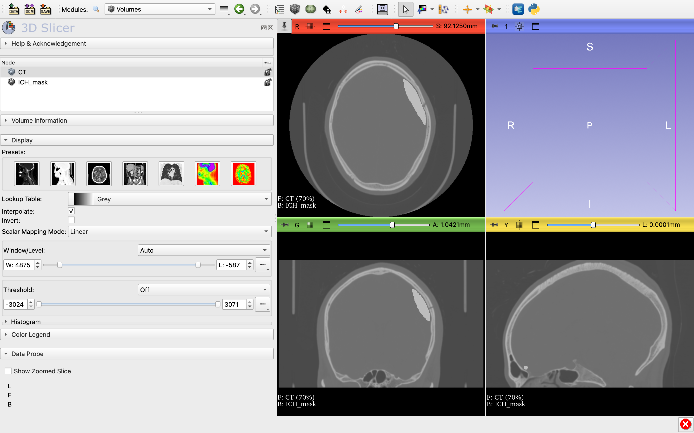

# Brain CT Visualization and ICH Mask Overlay

## Project Overview
This project explores brain CT visualization using 3D Slicer and the overlay of an existing intracranial hemorrhage (ICH) mask on a CT volume.

## Dataset
- **Dataset:** Seg-CQ500
- **Modality:** Computed Tomography (CT)
- **Image format:** NIfTI
- **Reference mask:** ICH mask provided with the dataset

## Tools
- 3D Slicer
- NIfTI medical imaging files

## Workflow
1. Loaded the brain CT volume into 3D Slicer.
2. Loaded the corresponding ICH mask.
3. Displayed the mask as a foreground overlay on the CT volume.
4. Adjusted overlay opacity to inspect the relationship between the mask and the underlying CT image.
5. Saved a 3D Slicer scene for later review.

## Project Scope
The work focuses on medical image visualization and inspection of an existing reference mask. The mask was provided by the dataset and was not manually created from scratch.

## Screenshot

## Key Skills
- Medical image visualization
- NIfTI file handling
- 3D Slicer workflow
- CT and segmentation-mask inspection
